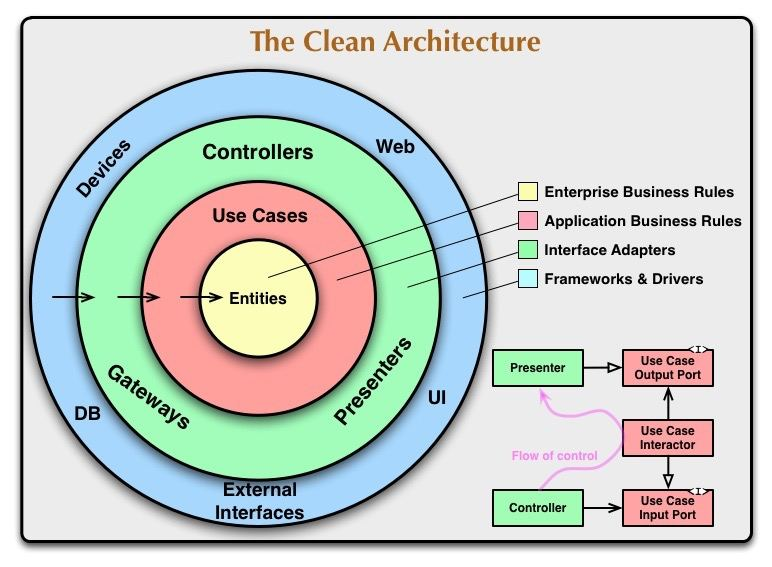

# Введение
Проект, реализующий работу с:
1. Web sessions
2. RBAC

# Проект
## Технологический стек
- **Python**: `3.12`
- **Production**: `alembic`, `dishka`, `fastapi`, `psycopg`, `sqlalchemy[async]`, `gunicorn`
- **Development**: `isort`, `ruff`, `pre-commit`


## Как работают веб-сессии

Регистрация и вход выполняются по email. Адрес приводится к нижнему регистру
без пробелов по краям; повторная регистрация такого же email запрещена.
Пароли хранятся в виде хешей Argon2id.

После успешного входа сервер создаёт сессию и передаёт браузеру случайный токен
в HttpOnly-cookie. В PostgreSQL сохраняется только HMAC-SHA256 хеш токена,
идентификатор пользователя и срок действия сессии. Сам токен в базе не хранится.

Браузер отправляет cookie с последующими запросами. Сервер вычисляет хеш токена,
находит сессию и проверяет её срок действия, активность пользователя и необходимые
права доступа. Если до истечения осталось не больше половины срока, сессия
продлевается, а cookie обновляется.

У пользователя может быть несколько независимых сессий — например, на телефоне
и компьютере. При выходе удаляется только текущая сессия; остальные устройства
сохраняют доступ. Истёкшая или удалённая сессия больше не позволяет авторизоваться.

Срок действия задаётся в `SESSION_EXPIRATION_MINUTES`, а секрет для хеширования —
в `SESSION_TOKEN_HASH_SECRET`. По умолчанию cookie передаётся только по HTTPS;
для локального HTTP используются `SESSION_COOKIE_NAME=session` и
`SESSION_COOKIE_SECURE=false`.

## API
### General
- '/': Открыт для **всех**
   - Перенаправляет на Swagger документацию

### Auth (`/auth`)

- 'signup' (POST): Открыт для **всех**
  - Регистрация аккаунта
- 'login' (POST): Открыт для **всех**
  - Вход в аккаунт
- 'logout' (DELETE): Открыт для **всех**
  - Выход с аккаунта
### Hello world (`/hello_world`)
- 'user' (GET): Открыт для **user**
  - return: Hello world by user
- 'admin' (GET): Открыт для **admin**
  - return: Hello world by admin

## Файловая структура

```
.
├── conf # конфиги
├── docs # документация
└── src
    └── auth
        ├── application # логика приложения и интерфейсы
        ├── domain # модели
        ├── entrypoint # настройка запуска
        ├── infrastructure # адаптеры
        └── presentation # внешнее общение

```

## Описание схем реляционной базы данных
Использован императивный подход. С помощью `map_imperatively` была смаплена доменная модель в представление базы данных.

## Зависимости
Приложение разделено на слои:
1. Domain
2. Application
3. Infrastructure
4. Presentation

<p align="center">
  
  <br><em>Чистая архитектура, Роберт Мартин</em>
</p>

- Соблюден принцип инверсии зависимотей
- Зависимости доставляются при помощи инъекции зависимостей, используя di-framework Dishka

## Переменные окружения
Для работы проекта необходимо настроить переменные окружения. В корне проекта подготовлены шаблоны:
- `.env.example` — используйте для локального запуска сервисов (localhost).
- `.env.docker.example` — используйте для запуска всего стека через Docker Compose.

Скопируйте нужный шаблон в соответствующий файл (`.env` или `.env.docker`) и заполните актуальные значения перед запуском.

При локальном запуске `make app` и команды миграций загружают `.env` через uv.
В Docker переменные окружения передаются через Compose.

## Как запустить
1. Склонируй проект
2. Заполни переменные окружения
3. Подними проект ``docker compose up --build``
4. Проведи миграции. Либо напрямую в контейнере, либо ``make migrate`` в терминале

## CodeGraph для работы с AI-агентами

Проект использует локальный CodeGraph, чтобы Codex, Claude Code, Gemini, Cursor
и другие AI-агенты могли находить связи между файлами, символами и вызовами без
повторного чтения всего репозитория.

После клонирования перейди в корень проекта, установи CLI и один раз создай
индекс:

```bash
npm install -g @colbymchenry/codegraph
codegraph init
codegraph status
```

Команда `codegraph status` должна показать актуальный индекс. Данные хранятся
только локально в `.codegraph/` и не попадают в Git. Индекс автоматически
обновляется при изменении файлов.

Любой агент может использовать универсальную команду:

```bash
codegraph explore "authentication login flow"
```

Нативное MCP-подключение настраивается отдельно в используемом клиенте и не
хранится в репозитории. Правила работы AI-агентов с проектом описаны в
`AGENTS.md`.

## Полезные материалы
1. Web sessions - https://cheatsheetseries.owasp.org/cheatsheets/Session_Management_Cheat_Sheet.html
2. OAuth2 - https://auth0.com/docs и https://oauth.net/
